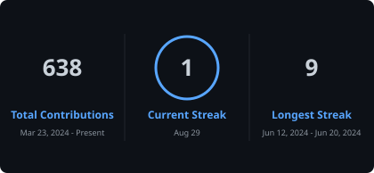
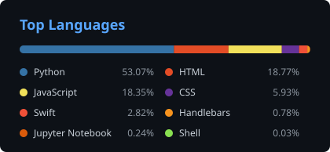

# Micah Read

Phygital DevOps. The page is the place, and the software is what the place does.

Studio: [phygitaldevops.com](https://phygitaldevops.com) · [Phygital-DevOps](https://github.com/Phygital-DevOps)

[GitHub](https://github.com/P5YC0DR3AM3R) · [LinkedIn](https://www.linkedin.com/in/micahreadmgmt/) · [micahreadmgmt@gmail.com](mailto:micahreadmgmt@gmail.com) · [micah@lyricshow.live](mailto:micah@lyricshow.live)

## What is live

| Site | What it is | How it ships |
|---|---|---|
| [phygitaldevops.com](https://phygitaldevops.com) | Studio site. The world is the page. | Vite, React Three Fiber, GitHub Pages |
| [lyricshow.live](https://lyricshow.live) | On-device live captions and translation into OBS | Next.js, Netlify, Firebase. A Workers cutover is merged and not switched |
| [sevenheavensmechanic.com](https://sevenheavensmechanic.com) | Mechanics shop and admin | Cloudflare Pages. `sevenheavens.com` is not this shop |
| [amaaudiocustoms.com](https://amaaudiocustoms.com) | Audio shop | GitHub Pages, Next static export |
| [spidersperts.com](https://spidersperts.com) | The site is the game | GitHub Pages |
| [striperviper.com](https://striperviper.com) | Lake Lanier charter, carried by a runner | GitHub Pages |
| [momentonmain.events](https://momentonmain.events) | Venue desk. Quote, book, manage | Cloudflare Worker. Deploy is manual |
| [elite-fiberglass.com](https://elite-fiberglass.com) | Fiberglass, paint, gelcoat | Cloudflare Worker. Deploy is manual |

## In the shop, not a public site

| Repo | What it is |
|---|---|
| [Key-West-Treasure-Hunt](https://github.com/Phygital-DevOps/Key-West-Treasure-Hunt) | Unreal Engine 5.8. Not a website |
| [DECKNER](https://github.com/Phygital-DevOps/DECKNER) | Boat systems. Private |
| [SevenMileSunsetLive](https://github.com/Phygital-DevOps/SevenMileSunsetLive) | Seven Mile Bridge stream. No public homepage set |
| [Phygital-Accounts](https://github.com/Phygital-DevOps/Phygital-Accounts) | Sign-in workers. Not live |
| [OpheliasKey](https://github.com/P5YC0DR3AM3R/OpheliasKey) | Vessel project. Private. Python, Typer, FastAPI, Pydantic |
| [Sony_Blu-Ray](https://github.com/P5YC0DR3AM3R/Sony_Blu-Ray) | SwiftUI remote for a Sony BDP-S5100 |
| [Patent-Miner](https://github.com/P5YC0DR3AM3R/Patent-Miner) | Expired-patent scoring. The page scores locally. It does not call a model to draw the dashboard |
| Redman | Retired redirect |

## Stack in use

- Web: Vite, Next.js, React, TypeScript, Tailwind
- 3D: Three.js, React Three Fiber, Blender, Unreal Engine 5.8
- Edge: Cloudflare Workers and Pages. GitHub Pages where a merge is the deploy
- Native: SwiftUI
- Python: FastAPI, Typer, Pydantic. Streamlit only for Patent Miner
- CI: Actions pinned to a commit SHA, `contents: read`, Node 22 on the runners

Classroom repos from 2024 are still on the account. They are exercises, not this stack.

## Work

| Place | Role | Years |
|---|---|---|
| Phygital DevOps | Creator | 2025 – present |
| Self employed | Voice and guitar | 2002 – present |
| Hard Rock Hotel, Universal Orlando | Singer | 2011 – present |
| BookIt Entertainment | Performing artist | 2009 – 2022 |
| MRMG Live | Senior partner | 2017 – 2019 |
| Fishlips, Cape Canaveral | Entertainment director | 2014 – 2020 |

EdX / UCF Full Stack Flex, graduated June 2024. Applied Generative AI specialization, University of Michigan / Simplilearn, October 2025.

  
  

## License

[MIT](LICENSE)
